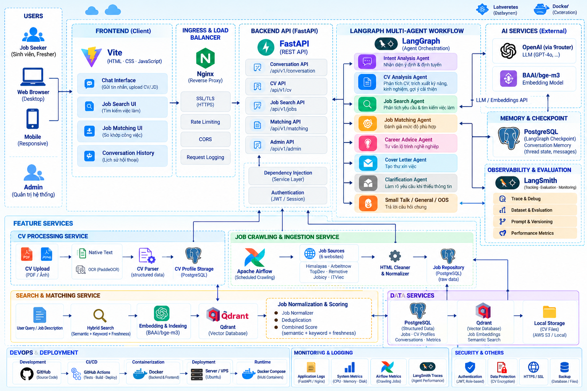
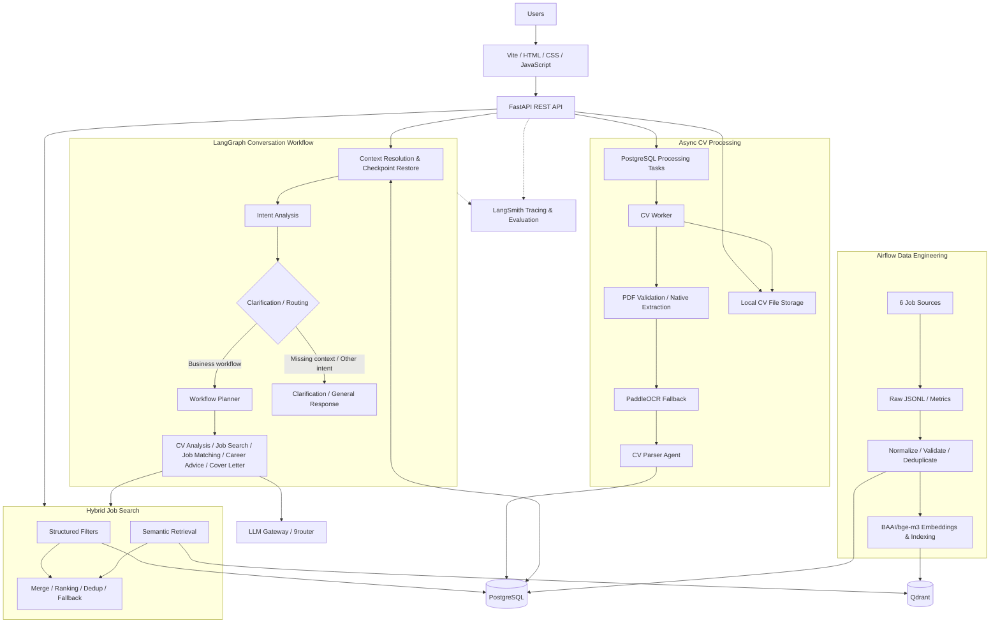
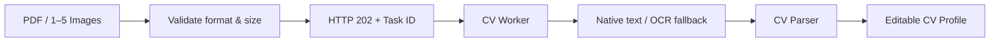
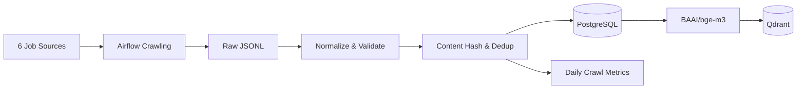

<div align="center">

# Multi-Agent Job Assistant

Hệ thống trợ lý hướng nghiệp sử dụng kiến trúc Multi-Agent để phân tích CV, tìm kiếm việc làm, đánh giá độ phù hợp với vị trí tuyển dụng và hỗ trợ ứng viên chuẩn bị hồ sơ ứng tuyển.


[**Tính năng**](#-tính-năng-nổi-bật) · [**Kiến trúc**](#-kiến-trúc-hệ-thống) · [**Cài đặt**](#-bắt-đầu) · [**Kiểm thử**](#-kiểm-thử) · [**Roadmap**](#-lộ-trình-phát-triển)

</div>

---

## Tổng quan

**Multi-Agent Job Assistant** kết hợp LLM với dữ liệu tuyển dụng được thu thập và chuẩn hóa, phục vụ các tác vụ từ đọc CV đến đề xuất công việc và tư vấn nghề nghiệp. **LangGraph** đảm nhiệm điều phối quy trình hội thoại; **PostgreSQL** lưu dữ liệu nghiệp vụ; **Qdrant** hỗ trợ truy xuất ngữ nghĩa; **Apache Airflow** tự động hóa pipeline dữ liệu việc làm.

> [!NOTE]
> Đây là dự án đang phát triển. Các điểm đánh giá CV và Job Matching là kết quả theo rubric/heuristic của hệ thống, **không phải xác suất trúng tuyển**. Việc đánh giá thực nghiệm và triển khai production vẫn đang được hoàn thiện.

## ✨ Tính năng nổi bật

| Nhóm | Khả năng |
| --- | --- |
| **CV Processing** | Nhận một PDF hoặc 1–5 ảnh theo thứ tự trang; trích xuất native text và OCR bằng PaddleOCR; tạo CV profile có cấu trúc và cho phép người dùng kiểm tra/chỉnh sửa. |
| **CV Analysis** | Phân tích chất lượng CV, điểm mạnh, điểm yếu và gợi ý cải thiện. |
| **Hybrid Job Search** | Kết hợp PostgreSQL và Qdrant; lọc theo địa điểm, seniority, kỹ năng, hình thức làm việc, mức lương và các trường khác. |
| **Job Matching** | So khớp CV với JD, phân tích bằng chứng, kỹ năng còn thiếu và đưa ra mức độ phù hợp. |
| **Career Advice** | Đề xuất định hướng, kỹ năng và lộ trình phát triển nghề nghiệp. |
| **Cover Letter** | Hỗ trợ soạn thư ứng tuyển dựa trên CV và vị trí công việc. |
| **Data Pipeline** | Thu thập, chuẩn hóa, loại trùng, cập nhật dữ liệu tuyển dụng; tạo embedding và index; tổng hợp metrics hàng ngày. |
| **Conversation Memory** | Lưu hội thoại và trạng thái xử lý bằng LangGraph Checkpoint. |

## 🏗 Kiến trúc hệ thống




Chi tiết thiết kế: [Architecture — As Is](docs/architecture-as-is.md).

### Multi-Agent workflow

1. **Prepare & Resolve Context:** tiếp nhận tin nhắn, `cv_id`, JD và khôi phục trạng thái hội thoại.
2. **Intent Analysis:** xác định ý định, kiểm tra thông tin cần thiết và yêu cầu bổ sung nếu thiếu.
3. **Workflow Planning & Routing:** lựa chọn một agent hoặc chuỗi agent tương ứng với yêu cầu.
4. **Agent Execution:** thực thi tác vụ, sử dụng dữ liệu CV, JD và job search phù hợp.
5. **Response & Checkpoint:** trả kết quả và lưu trạng thái cho các lượt tiếp theo.

Các agent chính sử dụng input/output có cấu trúc qua **Pydantic**:

| Agent | Vai trò |
| --- | --- |
| CV Parser | Chuyển văn bản CV thành profile có cấu trúc. |
| CV Analysis | Đánh giá chất lượng và đề xuất cải thiện CV. |
| Job Search | Phân tích yêu cầu và lập kế hoạch tìm kiếm. |
| Job Matching | Đánh giá CV so với yêu cầu của JD. |
| Career Advice | Gợi ý kỹ năng và lộ trình nghề nghiệp. |
| Cover Letter | Tạo bản nháp thư ứng tuyển phù hợp. |

## 🔎 Tìm kiếm và đánh giá độ phù hợp

### Hybrid Search

Hệ thống lọc và truy xuất ứng viên công việc từ **PostgreSQL** và **Qdrant**, hợp nhất theo `job_id`, khử trùng lặp và xếp hạng kết quả. Khi Qdrant không khả dụng, hệ thống có cơ chế fallback về PostgreSQL.

Điểm xếp hạng baseline:

```text
Final Score = 0.60 × Semantic Score
            + 0.30 × Keyword Score
            + 0.10 × Freshness Score
```

| Thành phần | Ý nghĩa |
| --- | --- |
| Semantic (60%) | Mức tương đồng ngữ nghĩa giữa truy vấn và tin tuyển dụng. |
| Keyword (30%) | Mức độ khớp từ khóa ở tiêu đề, kỹ năng và mô tả. |
| Freshness (10%) | Độ mới của tin đăng. |

Các trọng số là **baseline**, cần kiểm chứng trên tập truy vấn được gán nhãn bằng `Recall@K`, `nDCG@K` và tỷ lệ vi phạm filter. `total` chỉ phản ánh số kết quả đã khử trùng lặp trong cửa sổ truy xuất, **không phải** tổng số bản ghi toàn cơ sở dữ liệu.

### Job Matching

| Tiêu chí | Trọng số |
| --- | ---: |
| Technical Skills | 40% |
| Experience | 25% |
| Projects | 15% |
| Education | 10% |
| Languages & Certifications | 10% |

Nếu một tiêu chí không áp dụng, hệ thống loại tiêu chí đó và chuẩn hóa lại trọng số.

| Điểm | Phân loại |
| --- | --- |
| ≥ 85 | Strong Match |
| 70–<85 | Good Match |
| 50–<70 | Partial Match |
| < 50 | Low Match |

## 📄 Xử lý CV



**Quy tắc upload:** nhận **một PDF** hoặc **1–5 ảnh PNG/JPG/JPEG**, không trộn hai loại trong một lần upload; tối đa **10 MB mỗi file**, **50 MB tổng cộng**. Với CV nhiều ảnh, hệ thống ghép theo thứ tự đã chọn trước khi xử lý. API trả **HTTP 202** và `task_id`; frontend theo dõi trạng thái qua `GET /api/v1/cvs/processing-tasks/{task_id}`. Worker lưu trạng thái, số lần thử lại và processing lease trong PostgreSQL.

## 🗃 Pipeline dữ liệu tuyển dụng

Nguồn thu thập hiện được cấu hình gồm **Himalayas, Arbeitnow, TopDev, Remotive, Jobicy và ITViec**.



Pipeline ghi nhận `fetched`, `normalized`, `failed`, `inserted`, `updated`, `unchanged` và kiểm tra độ mới của dữ liệu. **150–200 job/ngày** là mục tiêu giám sát, không phải cam kết dữ liệu thực tế. Mỗi bản ghi nguồn có vector riêng trong collection `jobs_bge_m3_v2`; thay đổi mô hình hoặc định dạng văn bản embedding cần cập nhật version tương ứng.

Chạy nạp lại job hiện có vào chỉ mục vector (từ thư mục `backend/`):

```bash
python -m app.cli index-jobs --batch-size 100
```

## 🧰 Công nghệ

| Thành phần | Stack |
| --- | --- |
| Backend & API | Python 3.12, FastAPI, Pydantic, SQLAlchemy, Alembic |
| LLM & Orchestration | LangChain, LangGraph, LangSmith |
| Persistence & Search | PostgreSQL, Qdrant, BAAI/bge-m3 |
| Document Processing | PyMuPDF, PaddleOCR |
| Data Engineering | Apache Airflow, JSONL |
| Frontend | HTML, CSS, Vanilla JavaScript, Fetch API, Vite |
| Development | Docker, Docker Compose, pytest |

## 📁 Cấu trúc dự án

```text
multi-agent-job-assistant/
├── backend/
│   ├── alembic/              # Database migrations
│   └── app/
│       ├── agents/           # Specialized agents
│       ├── api/              # REST endpoints
│       ├── core/             # Configuration / core utilities
│       ├── crawlers/         # Job ingestion
│       ├── database/         # Database integrations
│       ├── embeddings/       # Embedding pipeline
│       ├── graphs/           # LangGraph workflows
│       ├── llm/              # LLM integrations
│       ├── memory/           # Conversation state
│       ├── normalizers/      # Job normalization
│       ├── prompts/          # Agent prompts
│       ├── repositories/     # Data access
│       ├── schemas/          # Pydantic schemas
│       ├── services/         # Business logic
│       └── vectorstores/     # Qdrant integration
├── airflow/
│   ├── dags/
│   └── docker-compose.yaml
├── frontend/
│   ├── src/
│   └── index.html
├── images/
└── README.md
```

## 🚀 Bắt đầu

### Yêu cầu

- **Docker + Docker Compose** nếu chạy bằng container.
- Hoặc **Python 3.12**, **Node.js/npm** và các dịch vụ phụ thuộc (như PostgreSQL, Qdrant) nếu chạy thủ công.
- Cấu hình API key và biến môi trường thích hợp. Không commit `.env` hoặc khóa truy cập.

### Cách 1 — Docker Compose (khuyến nghị cho môi trường development)

Tại thư mục gốc dự án, tạo `backend/.env.docker` theo cấu hình của môi trường rồi chạy:

```bash
docker compose up --build
```

Compose sử dụng các service hỗ trợ như `migrate`, `ocr-model-init`, `cv-worker` và volume chung `backend_storage`. Địa chỉ development theo cấu hình hiện tại:

| Dịch vụ | URL |
| --- | --- |
| Frontend | http://127.0.0.1:5173 |
| Backend API | http://127.0.0.1:8001 |
| Swagger UI | http://127.0.0.1:8001/docs |

Sau khi sửa cấu hình runtime, có thể khởi động lại các service ứng dụng:

```bash
docker compose restart backend cv-worker frontend
```

### Cách 2 — Chạy thủ công (Windows PowerShell)

**1. Backend**

```powershell
cd backend
python -m venv venv
.\venv\Scripts\Activate.ps1
pip install -r requirements.txt
Copy-Item .env.example .env
# Chỉnh sửa backend/.env trước khi chạy
alembic upgrade head
uvicorn app.main:app --reload
```

Backend mặc định: `http://127.0.0.1:8000` · API docs: `http://127.0.0.1:8000/docs`.

**2. CV Worker** — mở terminal riêng trong `backend/` và kích hoạt môi trường Python:

```powershell
python -m app.cli cv-worker
# Hoặc xử lý một task rồi thoát:
python -m app.cli cv-worker --once
```

**3. Frontend** — mở terminal mới từ thư mục gốc:

```powershell
cd frontend
npm install
npm run dev
```

Frontend mặc định: `http://127.0.0.1:5173`.

> [!IMPORTANT]
> Với chế độ chạy thủ công, cần bảo đảm PostgreSQL, Qdrant và các cấu hình kết nối được thiết lập đúng trước khi khởi chạy. Mẫu `.env.example` trong repository là điểm tham chiếu cho các biến môi trường thực tế.

## 📍 Trạng thái dự án

| Đã triển khai | Đang tiếp tục hoàn thiện |
| --- | --- |
| Multi-Agent workflow; CV parsing/analysis; hybrid search; job matching; career advice; cover letter | LangSmith evaluation và bộ dữ liệu đánh giá có gán nhãn |
| Conversation checkpoint; authentication và ownership cho CV/hội thoại | Unit / integration / end-to-end test mở rộng |
| PDF/ảnh CV, OCR worker bất đồng bộ, chỉnh sửa profile | Human-in-the-loop |
| Airflow crawling; search context; snapshot phân trang; frontend | Health checks, CI và production deployment |

### Giới hạn hiện tại

- Giới hạn upload là một PDF hoặc tối đa năm ảnh, chưa hỗ trợ upload trộn.
- CV được lưu trên filesystem/volume backend; chưa chuyển sang object storage production.
- Điểm matching và ranking cần được hiệu chỉnh bằng dữ liệu được gán nhãn.
- Kết quả tìm kiếm phụ thuộc chất lượng, metadata và độ mới của job đã thu thập/index.
- Snapshot cũ không tự cập nhật sau khi thuật toán thay đổi; cần tìm kiếm mới.
- Chưa có bộ kiểm thử và hệ thống đánh giá LLM tự động đầy đủ.

## 🗺 Lộ trình phát triển

- [ ] Mở rộng unit, integration và end-to-end tests.
- [ ] Hoàn thiện GitHub Actions CI và health checks.
- [ ] Xây dựng dataset và LangSmith evaluation cho Intent Analysis, Job Search, Job Matching.
- [ ] Hiệu chỉnh ranking/matching theo metrics và dữ liệu thực tế.
- [ ] Hoàn thiện human-in-the-loop.
- [ ] Củng cố bảo vệ dữ liệu CV và triển khai production.

---

<div align="center">

**Multi-Agent Job Assistant** · AI Engineering × Data Engineering

</div>
