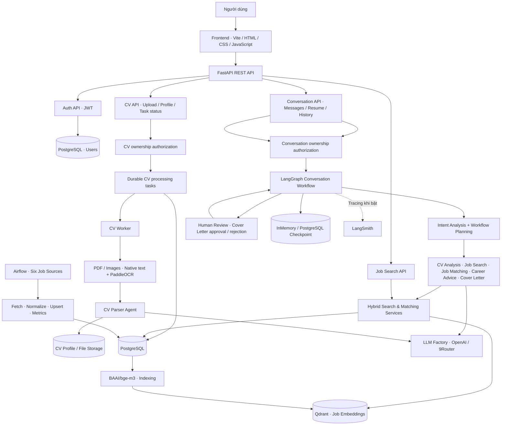
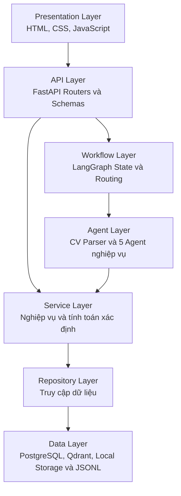
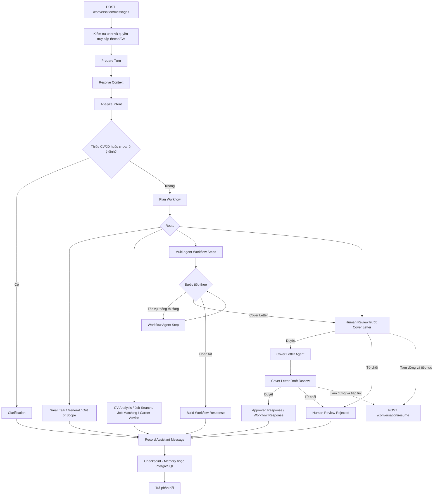
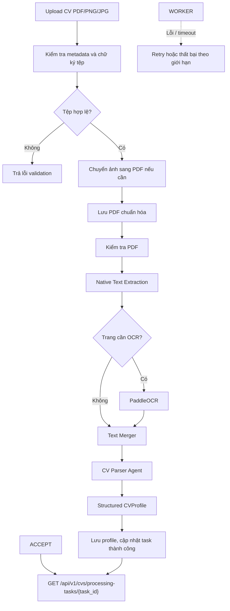
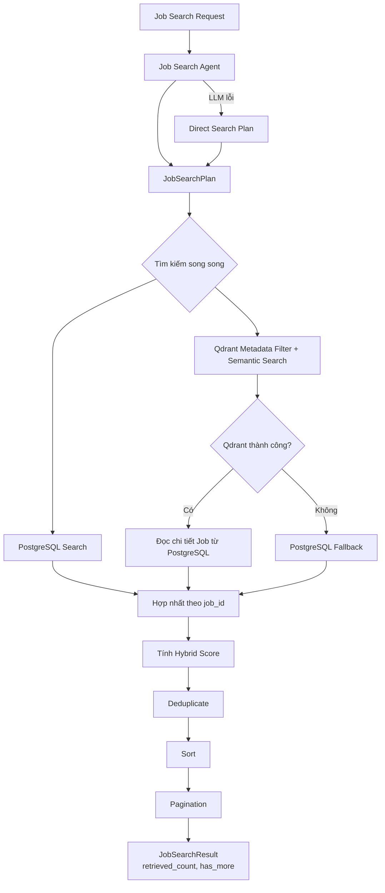
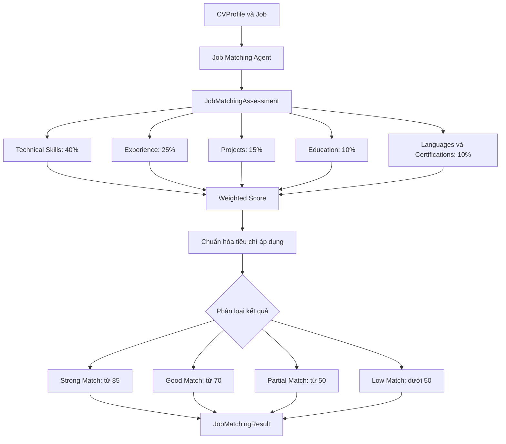
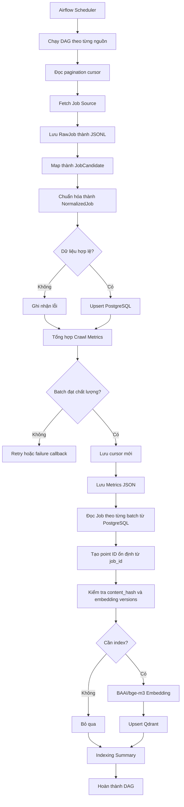

# Kiến trúc hệ thống hiện tại – As-is Architecture

Tài liệu này mô tả kiến trúc đã được triển khai trên nhánh `main` của hệ thống
Multi-Agent Job Assistant.

Tài liệu phản ánh mã nguồn trên nhánh `main`, không đồng nghĩa mọi thành phần đã được triển khai production. Authentication/JWT, kiểm soát quyền truy cập CV và hội thoại, xử lý CV bất đồng bộ và Human-in-the-loop cho Cover Letter đã có trong mã nguồn. Các hệ thống tùy chọn như PostgreSQL checkpoint, Qdrant và LangSmith tracing cần cấu hình phù hợp để hoạt động.

## 1. Kiến trúc tổng thể



> Các mũi tên thể hiện phụ thuộc logic, không nhất thiết là lời gọi đồng bộ. CV upload trả tác vụ để worker xử lý sau; cơ chế checkpoint có thể dùng bộ nhớ hoặc PostgreSQL theo cấu hình.

## 2. Các tầng kiến trúc



### Presentation Layer

Frontend sử dụng:

- HTML.
- CSS.
- Vanilla JavaScript.
- Fetch API.
- Vite.

Frontend chịu trách nhiệm:

- Đăng ký, đăng nhập và lưu trạng thái xác thực trên frontend.
- Upload CV PDF hoặc các trang ảnh PNG/JPEG; theo dõi trạng thái tác vụ xử lý CV.
- Nhập câu hỏi.
- Nhập Job Description.
- Hiển thị danh sách việc làm.
- Hiển thị kết quả CV Analysis.
- Hiển thị Job Matching.
- Hiển thị Career Advice và Cover Letter.
- Quản lý danh sách cuộc hội thoại trên trình duyệt.
- Tiếp tục hội thoại sau bước Human Review của Cover Letter.

Mã nguồn chính:

```text
frontend/index.html
frontend/src/main.js
frontend/src/api/
frontend/src/features/
frontend/src/css/
```

### API Layer

FastAPI cung cấp các nhóm API:

| API | Trách nhiệm |
|---|---|
| Health API | Kiểm tra trạng thái ứng dụng (được đăng ký ngoài các nhóm API v1 nếu có) |
| Auth API · `/api/v1/auth` | Register, login, thông tin người dùng hiện tại |
| CV API · `/api/v1/cvs` | Upload CV (202 Accepted), trạng thái task, lấy/sửa/xóa CV sở hữu |
| Job API · `/api/v1/jobs/search` | Tìm kiếm việc làm |
| Conversation API · `/api/v1/conversation` | Gửi message, intent analysis, xem/xóa lịch sử và resume Human Review |

Mã nguồn chính:

```text
backend/app/main.py
backend/app/api/router.py
backend/app/api/v1/router.py
backend/app/api/v1/endpoints/
```

### Workflow Layer

LangGraph chịu trách nhiệm:

- Lưu Conversation State.
- Khôi phục conversation context.
- Phân tích ý định.
- Kiểm tra dữ liệu còn thiếu.
- Lập kế hoạch workflow.
- Điều hướng đến Agent.
- Chạy multi-agent workflow.
- Lưu checkpoint và lịch sử hội thoại.
- Tạm dừng/tiếp tục workflow cho Human Review trước và sau bản nháp Cover Letter.

Mã nguồn chính:

```text
backend/app/graphs/conversation/state.py
backend/app/graphs/conversation/builder.py
backend/app/graphs/conversation/routing.py
backend/app/graphs/conversation/planning.py
backend/app/graphs/conversation/nodes.py
backend/app/graphs/conversation/workflow.py
```

### Agent Layer

Hệ thống có CV Parser Agent trong pipeline CV và năm Agent nghiệp vụ trong LangGraph (Intent Analysis là tầng phân tích/điều phối, không tính là một Agent nghiệp vụ độc lập trong bảng):

| Agent | Input chính | Output chính |
|---|---|---|
| CV Parser Agent | Nội dung CV | CVProfile |
| CV Analysis Agent | CVProfile | CVAnalysisResult |
| Job Search Agent | Truy vấn và CV context | JobSearchPlan |
| Job Matching Agent | CVProfile và Job | JobMatchingAssessment |
| Career Advice Agent | CV và matching evidence | CareerAdviceResult |
| Cover Letter Agent | CV và Job Description | CoverLetterResult |

Mã nguồn:

```text
backend/app/agents/
backend/app/prompts/
backend/app/schemas/
```

Mỗi Agent chỉ thực hiện một trách nhiệm và sử dụng structured output thay vì
trả dữ liệu tự do cho Agent khác.

### Service Layer

Service Layer chứa nghiệp vụ không nên đặt trực tiếp trong Agent hoặc API.

Các trách nhiệm chính:

- Tiếp nhận tác vụ CV bền vững và xử lý bằng worker độc lập.
- Xử lý PDF hoặc các trang ảnh CV.
- Hợp nhất native text và OCR.
- Tính điểm Job Matching.
- Tìm kiếm và xếp hạng việc làm.
- Điều phối conversation.
- Thu thập và chuẩn hóa job.

Mã nguồn:

```text
backend/app/services/
```

### Repository Layer

Repository Layer tách nghiệp vụ khỏi cách lưu trữ dữ liệu.

Mã nguồn:

```text
backend/app/repositories/
```

Các repository hiện tại chịu trách nhiệm:

- Lưu và đọc CVProfile, kiểm soát quyền sở hữu dữ liệu.
- Quản lý tác vụ xử lý CV có trạng thái/lease/retry.
- Truy cập dữ liệu người dùng phục vụ xác thực.
- Lưu dữ liệu job dạng JSONL.
- Upsert job vào PostgreSQL.
- Truy vấn ứng viên việc làm.
- Đọc job phục vụ quá trình indexing.

### Data Layer

| Thành phần | Dữ liệu |
|---|---|
| PostgreSQL | Job đã chuẩn hóa, user/auth và các bản ghi tác vụ CV theo mô hình triển khai |
| Conversation Checkpoint | InMemorySaver (mặc định theo cấu hình code) hoặc AsyncPostgresSaver |
| Qdrant | Vector embedding của việc làm |
| Local Storage | File CV và các artifact xử lý CV theo storage backend |
| JSONL | Dữ liệu job thô |
| Metrics JSON | Kết quả crawl theo batch và theo ngày |

## 3. Luồng Conversation Workflow



**Human-in-the-loop:** graph có các node `human_review`, `cover_letter_draft_review`, `cover_letter_approved` và `human_review_rejected`. API `POST /api/v1/conversation/resume` cho phép tiếp tục một phiên đang chờ xét duyệt. Quyết định Human Review và cơ chế khôi phục cần checkpoint thích hợp; không coi đây là quy trình duyệt thủ công cho tất cả Agent.

## 4. Luồng CV Processing



Đầu vào được mô tả trong API là một PDF hoặc tối đa số trang ảnh PNG/JPEG theo cấu hình (mặc định 5). API không chờ phân tích CV hoàn tất mới trả response. Worker được triển khai tại `backend/app/cli/cv_worker.py`; task/retry được quản lý qua service và repository. Có các endpoint lấy, cập nhật và xóa CV đã sở hữu.

## 5. Luồng Hybrid Job Search



Qdrant áp dụng metadata filter trước semantic top-K. PostgreSQL xác nhận lại
filter khi tải source record. Hai tầng dùng cùng quy tắc salary currency và
salary period; không có quy đổi ngầm giữa tháng và năm. Location trên Qdrant
dùng `location_keys` đã chuẩn hóa, còn PostgreSQL mở rộng các alias phổ biến
trước khi tạo điều kiện `ILIKE`.

`total` chỉ là số job deduplicate trong cửa sổ ứng viên đã truy xuất.
`retrieved_count` là số source record sau khi hợp nhất và `has_more` thể hiện
khả năng còn trang tiếp theo; API không mô tả `total` như tổng chính xác của
toàn bộ database.

Công thức:

```text
Final Score =
    0.60 × Semantic Score
  + 0.30 × Keyword Score
  + 0.10 × Freshness Score
```

## 6. Luồng Job Matching



## 7. Luồng Job Crawling và Indexing



Qdrant lưu riêng từng source record bằng point ID được dẫn xuất ổn định từ
`job_id`. Chữ ký quyết định reindex gồm `content_hash`,
`embedding_model_version` và `embedding_text_version`. Deduplicate liên nguồn
được thực hiện trên kết quả tìm kiếm, không thực hiện bằng cách cho các nguồn
dùng chung một Qdrant point.

Khi chuyển từ collection `jobs_bge_m3_v1` sang `jobs_bge_m3_v2`, chạy full
sync bằng `python -m app.cli index-jobs --batch-size 100`. Các DAG sau đó tiếp
tục index tăng dần theo `job_ids` của từng batch crawl.

Khi `index_payload_version` thay đổi, cũng cần chạy full sync để các point cũ
có đủ metadata filter và payload index tương ứng.

## 8. Authentication, kiểm soát truy cập và Human Review

- `/api/v1/auth/register`, `/login`, `/me` được khai báo trong `backend/app/api/v1/endpoints/auth.py`.
- JWT Bearer được xác thực tại `backend/app/api/auth_dependencies.py`; user được tra cứu và kiểm tra trạng thái.
- CV API và Conversation API sử dụng các authorized service dependencies để ràng buộc quyền truy cập CV, task và thread với người dùng.
- Conversation có endpoint `/resume` để tiếp tục Human-in-the-loop, đồng thời xử lý xung đột trạng thái khi phiên bận hoặc không chờ review.
- Đây là xác thực và kiểm soát quyền sở hữu tài nguyên; không mặc định rằng RBAC nhiều vai trò hoặc giao diện quản trị đã hoàn chỉnh.

## 9. Observability, cấu hình và giới hạn As-is

- `backend/app/core/config.py` và `backend/.env.example` cung cấp cấu hình LangSmith tracing (mặc định tắt). Khi cấu hình API key, project và bật tracing, có thể theo dõi run của LangChain/LangGraph.
- Không đồng nhất việc có thư viện/cấu hình LangSmith với dataset đánh giá đã triển khai trên `main`; phần evaluation cần được xác nhận độc lập theo nhánh hoặc script thực tế.
- LLM provider được cấu hình cho OpenAI hoặc 9Router; embedding công việc sử dụng `BAAI/bge-m3`, Qdrant collection mặc định `jobs_bge_m3_v2`.
- Job storage và conversation checkpoint đều có backend có thể cấu hình. Default trong code có thể dùng JSONL và in-memory, không mặc định mọi bản triển khai đã dùng PostgreSQL.
- Chưa xác nhận từ mã nguồn đã kiểm tra: Nginx/load balancer, rate limiting, production deployment hoàn chỉnh, MinIO/S3, Redis/Celery, Interview Agent và collection Qdrant riêng cho CV. Không biểu diễn chúng thành thành phần bắt buộc đang chạy.
- Tài liệu này mô tả **chức năng có mã nguồn**, không phải chứng nhận về vận hành, khả năng chịu tải, độ an toàn production hoặc kết quả benchmark.